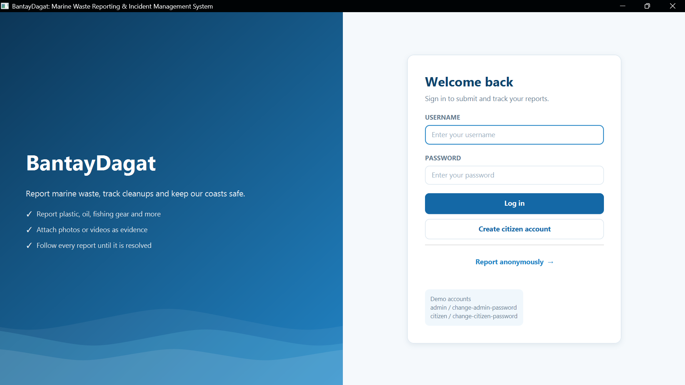
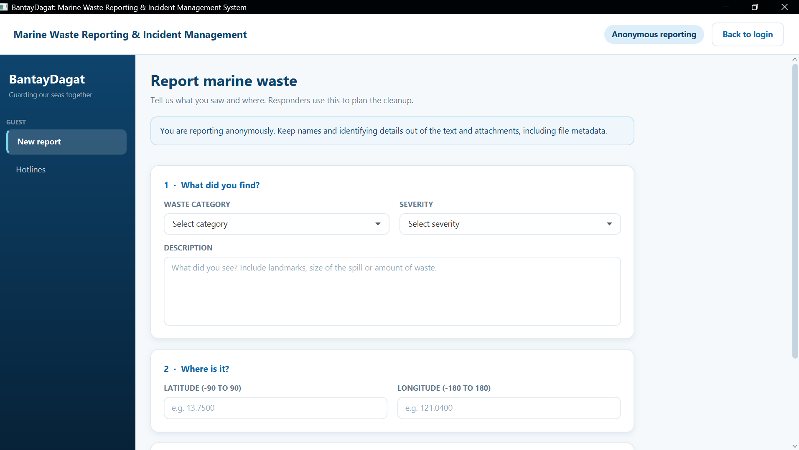
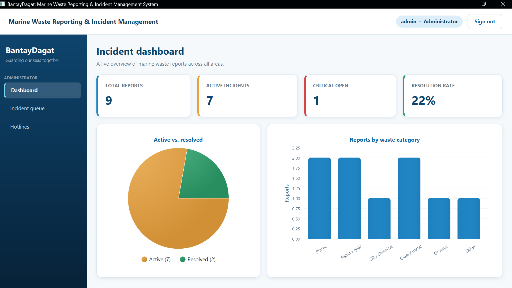
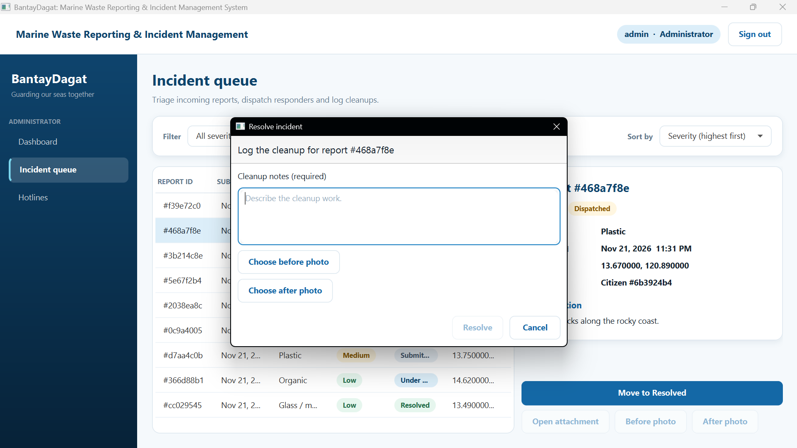

# BantayDagat
### Marine Waste Reporting & Incident Management System

BantayDagat is a desktop application designed to facilitate the reporting, monitoring, and management of marine waste incidents. It allows citizens to submit reports containing incident details, geographical coordinates, and photographic or video evidence. Administrators can review submitted reports, monitor incident progress, and document cleanup operations.

## The Problem

Marine waste pollution threatens marine ecosystems, coastal communities, and public health. Reporting incidents and coordinating cleanup activities can be difficult without an organized monitoring system.

BantayDagat aims to provide a centralized and structured way to document marine waste incidents, monitor their progress, and support more organized waste management efforts.

## Objectives

- Provide an accessible platform for reporting marine waste incidents.
- Allow citizens to document incidents with descriptions, locations, and media evidence.
- Enable administrators to review and manage submitted reports.
- Monitor incident progress through a structured status workflow.
- Maintain records of resolved incidents and corresponding cleanup activities.

## Target Users

- **Citizens:** Individuals who want to report marine waste incidents in their communities.
- **Administrators:** Personnel responsible for reviewing reports, managing incidents, and documenting cleanup operations.
- **Anonymous Reporters:** Individuals who wish to submit reports without creating an account.

## Main Features

- **Marine Waste Reporting:** Submit incidents with waste categories, severity levels, descriptions, and geographical coordinates.
- **Media Attachments:** Attach photographs and videos as supporting evidence.
- **Report Monitoring:** Allow registered citizens to view their submitted reports.
- **Incident Management:** Enable administrators to review, filter, sort, and update incident statuses.
- **Dashboard and Analytics:** Display report statistics, incident summaries, and waste category distributions.
- **Cleanup Documentation:** Record resolution notes and optional before-and-after photographs.
- **Hotlines Directory:** Provide access to relevant emergency and contact information.
- **User Authentication:** Support administrator and citizen accounts, as well as anonymous reporting.

## Technologies Used

| Technology | Purpose |
|---|---|
| Java 17 | Primary programming language |
| JavaFX 17 | Desktop graphical user interface |
| Maven | Dependency and project management |
| Java Serialization | Local application data persistence |
| CSS | Interface styling |

## Team Members and Roles

| Team Member | Role | Responsibilities |
|---|---|---|
| Christian Rocero | Lead Programmer | Application architecture, core functionality, and system integration |
| Kent Jasper Dagohoy | UI/UX Designer | Interface design, layouts, and visual consistency |
| Mon Raven Lapso | Documentation | Project documentation, technical writing, and presentation materials |
| Earl Yancy Navarro | Tester / Quality Assurance | Testing functionality, identifying bugs, and verifying system behavior |


## Object-Oriented Programming Concepts Demonstrated

- **Encapsulation:** Classes such as `User`, `Report`, and `IncidentManager` manage their internal data and expose controlled operations.
- **Inheritance:** `AdminUser` and `CitizenUser` inherit from the abstract `User` class. Similarly, `TextReport` and `MediaReport` inherit from `Report`.
- **Abstraction:** Abstract classes such as `User` and `Report` define shared structures and behavior without requiring direct instantiation.
- **Polymorphism:** Different report types are handled through their common `Report` type, allowing shared report-management operations.
- **Interfaces:** The `Reportable` interface defines a common reporting contract implemented by `Report`.

## Instructions for Running the Program

### Requirements
- JDK 17 or newer
- Apache Maven 3
- Internet connection for initial dependency downloads

### Run

1. Clone or download the repository.
2. Open a terminal in the project directory containing `pom.xml`.
3. Verify Java and Maven installations:

   ```powershell
   java -version
   mvn -version
   ```

4. Run the application:

   ```powershell
   mvn clean javafx:run
   ```

The application will launch through JavaFX. On its first run, demonstration accounts and sample reports are automatically generated for testing.

### Demo Accounts

| Role | Username | Password |
|---|---|---|
| Administrator | `admin` | `change-admin-password` |
| Citizen | `citizen` | `change-citizen-password` |

## 10. Sample Screenshots

### Login Page


### Report Page


### Administrator Dashboard


### Incident Management



## Known Limitations

- Application data are stored locally using Java serialization rather than a centralized database.
- Reports are not synchronized between different computers.
- Anonymous users cannot access personal report history.
- Geographic coordinates are recorded, but an interactive map is not currently available.
- The application currently relies on predefined demonstration administrator credentials.

## Future Improvements

- Integrate a centralized database for more reliable data management.
- Implement cloud-based storage and synchronization.
- Introduce interactive maps for visualizing reported incidents.
- Improve authentication and account management.
- Add report export functionality for documentation and analysis.
- Implement notifications to inform users about report status updates.
- Expand dashboard analytics to support more detailed environmental monitoring.

---

